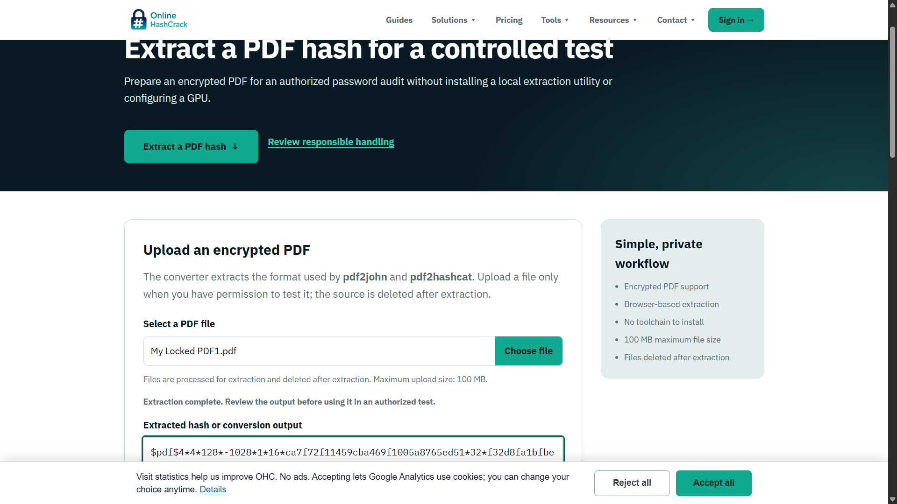

# 🔓 PDF Password Cracking Using John the Ripper

### Network Walks Cybersecurity Training – Week 3 | Batch B084

## 1. Project Overview

This project demonstrates the use of **John the Ripper**, an open-source password security auditing tool, to perform dictionary-based password recovery on a password-protected PDF document.

The practical involved extracting the PDF password hash, preparing it for John the Ripper, executing a wordlist-based password audit, and verifying the recovery result by opening the original PDF.

The exercise helped me understand how password hashes can be used during password security assessments and how dictionary attacks work.

## 2. Objectives

- Understand the purpose of PDF password hash extraction.
- Prepare an extracted PDF hash for password auditing.
- Set up and use John the Ripper on Windows.
- Perform a dictionary-based password audit using a wordlist.
- Check the recovered result using John the Ripper.
- Verify successful password recovery by opening the PDF.

## 3. Tools & Technologies Used

| Tool | Purpose |
|---|---|
| John the Ripper Jumbo 1.9.0 | Password auditing and recovery |
| PowerShell | Executing John the Ripper commands |
| PDF Hash Extractor | Extracting the password hash from the PDF |
| `password.lst` | Wordlist used for dictionary-based auditing |
| Windows | Operating environment |

## 4. Practical Implementation

### Step 1 – Downloading and Extracting John the Ripper

Downloaded the Windows 64-bit Jumbo build of John the Ripper and extracted the ZIP archive.

The `john.exe` executable was available inside the extracted `run` directory.

### Step 2 – Verifying the Installation

Opened PowerShell in the John the Ripper `run` directory and executed:

```powershell
.\john.exe --help
```

This displayed the available command-line options and confirmed that the executable could be run.

### Step 3 – Extracting the PDF Password Hash

Used an online PDF hash extraction tool to extract the password hash from the assigned protected PDF.

The extracted hash was copied into a text file named `hash1.txt` and stored locally for the practical.

The hash was kept private and was not included in this repository.

### Step 4 – Performing Dictionary-Based Password Auditing

Executed John the Ripper with the supplied wordlist and extracted hash file:

```powershell
.\john.exe --wordlist=password.lst "C:\Cybersecurity-Tools\Week3\Locked-Files\hash1.txt"
```

John the Ripper tested candidate passwords from the wordlist against the extracted PDF password hash.

### Step 5 – Checking the Recovery Result

Used the following command to display the recovered result:

```powershell
.\john.exe --show "C:\Cybersecurity-Tools\Week3\Locked-Files\hash1.txt"
```

The tool reported that the password hash had been successfully cracked.

### Step 6 – Verifying the PDF

Opened the original password-protected PDF and entered the recovered password.

The PDF opened successfully, confirming the password recovery result.

## 5. Screenshots & Evidence

The following screenshots document the major stages of the practical.

### 01. PDF Password Hash Extraction

Evidence of extracting the PDF-specific password hash.



### 02. John the Ripper Password Cracking Result

Evidence of executing the dictionary-based audit and obtaining a successful password recovery result.


### 03. PDF Unlock Verification

Evidence confirming that the original PDF opened successfully after password recovery.


## 6. Observations

- PDF password auditing requires the appropriate PDF-specific hash format.
- John the Ripper supports wordlist-based password auditing through its command-line interface.
- The `--wordlist` option allows candidate passwords to be tested from a supplied list.
- The `--show` option can be used to check previously recovered passwords.
- Successful recovery was confirmed by opening the original PDF.

## 7. Key Learning Outcomes

Through this practical, I learned:

1. How to download and use the John the Ripper command-line tool.
2. How to extract and prepare a PDF password hash.
3. How dictionary-based password auditing works.
4. How to execute John the Ripper commands through PowerShell.
5. How to verify password recovery using the original protected document.

## 8. Security & Ethical Considerations

This practical was performed for educational purposes using an assigned lab document.

- Password auditing should only be performed on documents that you own or are authorized to assess.
- Extracted hashes and recovered passwords must be kept confidential.
- Original protected documents, password hashes, and recovered passwords are not included in this public repository.
- Password-cracking techniques must never be used for unauthorized access.

## 9. Conclusion

This practical provided hands-on experience with John the Ripper and demonstrated how dictionary-based password auditing can be performed on password-protected PDF documents.

By extracting the PDF password hash, executing a wordlist-based audit, checking the recovery result, and verifying the original PDF, I gained a practical understanding of the basic PDF password-auditing workflow.

---

**Author:** Harini Madasu  
**Program:** Network Walks – Cybersecurity Training  
**Batch:** B084  
**Week:** 03  
**Project:** PDF Password Cracking Using John the Ripper
