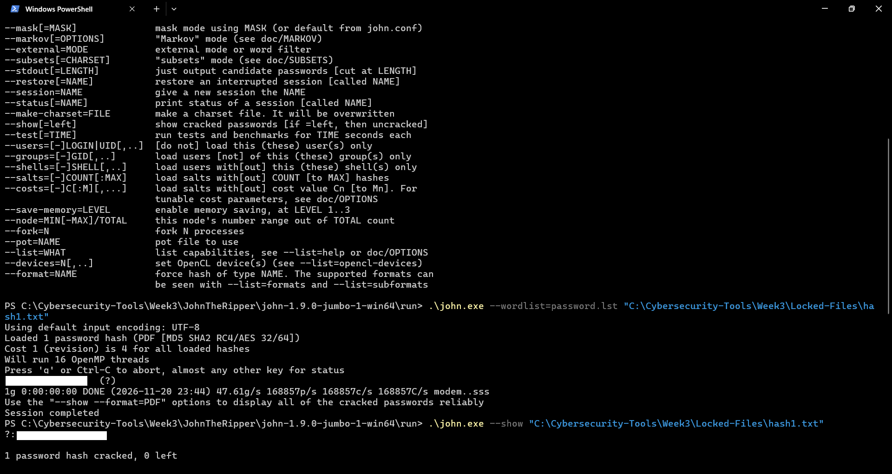

# PROJECT 1: 🔓 PDF Password Cracking Using John the Ripper

### John the Ripper Jumbo | Hash Extraction, Wordlist Attack and Password Verification

## 1. Project Overview

This practical demonstrates the use of **John the Ripper Jumbo**, an open-source password security auditing tool, to perform dictionary-based password recovery on an assigned password-protected PDF document.

The exercise involved extracting a PDF-specific password hash, preparing the hash for John the Ripper, executing a wordlist-based audit through Windows PowerShell, and verifying the recovered password by opening the original PDF.

The objective was to understand the command-line workflow involved in PDF password auditing and gain practical experience with a widely used password security tool.

## 2. Tools and Resources

| Tool | Purpose | Link |
|---|---|---|
| John the Ripper Jumbo | Password auditing and recovery | [Download – Openwall](https://www.openwall.com/john/) |
| PowerShell | Executing commands | Built into Windows |
| OnlineHashCrack PDF Hash Extractor | Extracting the PDF password hash | [Open Tool](https://www.onlinehashcrack.com/tools-pdf-hash-extractor.php) |
| `password.lst` | Wordlist for dictionary-based auditing | Included with the John package |

**Version used:** John the Ripper 1.9.0 Jumbo-1, Windows 64-bit.

**Interface used:** Command-Line Interface (CLI).

## 3. Objectives

- Download and configure John the Ripper on Windows.
- Verify the command-line executable.
- Extract the password hash from a protected PDF.
- Prepare the extracted hash in a text file.
- Perform dictionary-based password auditing.
- Display the recovered result.
- Verify successful recovery by opening the original PDF.

## 4. Methodology and Implementation

### Step 1 – Downloading John the Ripper

Downloaded the Windows 64-bit Jumbo build from the official Openwall website.

The downloaded ZIP archive was extracted, and the `john.exe` executable was located inside the `run` directory.

**Download:** [John the Ripper – Official Openwall Website](https://www.openwall.com/john/)

### Step 2 – Verifying the Installation

Opened PowerShell in the extracted John the Ripper `run` directory.

Executed the following command:

```powershell
.\john.exe --help
```

The command displayed the available options and usage information, confirming that John the Ripper could be executed successfully.

### Step 3 – Extracting the PDF Password Hash

Used the OnlineHashCrack PDF Hash Extractor to extract the password hash from the assigned protected PDF document.

**Tool:** [OnlineHashCrack – PDF Hash Extractor](https://www.onlinehashcrack.com/tools-pdf-hash-extractor.php)

The extracted PDF-specific hash was copied into a text file named `hash1.txt`.

The hash file was stored locally and was not uploaded to the public repository.

### Step 4 – Performing Dictionary-Based Password Auditing

Used the supplied `password.lst` wordlist to perform the password audit.

The following command was executed in PowerShell:

```powershell
.\john.exe --wordlist=password.lst "C:\Cybersecurity-Tools\Week3\Locked-Files\hash1.txt"
```

John the Ripper tested the candidate passwords in the wordlist against the extracted PDF password hash.

### Step 5 – Displaying the Recovery Result

After the cracking process, the following command was used:

```powershell
.\john.exe --show "C:\Cybersecurity-Tools\Week3\Locked-Files\hash1.txt"
```

The output indicated that the password hash had been successfully cracked.

The recovered password has been intentionally excluded from this documentation.

### Step 6 – PDF Verification

Opened the original password-protected PDF and entered the recovered password.

The PDF opened successfully, confirming that the password recovery process was successful.

## 5. Screenshots and Practical Evidence

The following screenshots document the major stages of the practical implementation.

### 5.1 PDF Hash Extraction

The PDF password hash was extracted using the OnlineHashCrack PDF Hash Extractor.


### 5.2 John the Ripper – Password Recovery Result

The command-line output shows the execution of John the Ripper and the successful password recovery result.



### 5.3 PDF Unlock Verification

The recovered password was used to open the original PDF successfully.


## 6. Commands Used

| Command | Description |
|---|---|
| `.\john.exe --help` | Displays command-line usage information |
| `.\john.exe --wordlist=password.lst hash1.txt` | Performs a wordlist-based password audit |
| `.\john.exe --show hash1.txt` | Displays previously recovered results |

## 7. Observations

- A PDF-specific password hash is required for this type of password auditing.
- John the Ripper supports dictionary-based password auditing through its wordlist option.
- PowerShell can be used to execute the tool directly from its extracted directory.
- The `--show` option provides a way to check previously recovered passwords.
- The final result was verified by successfully opening the original PDF.

## 8. Learning Outcomes

Through this practical, I gained experience in:

1. Downloading and running John the Ripper Jumbo on Windows.
2. Extracting PDF password hashes.
3. Preparing hash files for password auditing.
4. Executing wordlist-based password recovery through PowerShell.
5. Understanding the purpose of the `--wordlist` and `--show` options.
6. Verifying password recovery using the original document.

## 9. Security and Ethical Considerations

- The practical was performed using an assigned training document.
- Password auditing must only be performed on files that you own or have permission to assess.
- Extracted hashes and recovered passwords must be kept private.
- Original PDFs, hash files, and recovered passwords are excluded from this public repository.
- Strong, unique passwords should be used to protect sensitive documents.

## 10. Conclusion

This practical provided hands-on experience with John the Ripper Jumbo and its command-line password auditing capabilities.

The workflow covered PDF hash extraction, wordlist-based password auditing, result verification, and successful opening of the original protected PDF.

The exercise helped develop a practical understanding of dictionary-based password attacks and the importance of secure password selection.

## 11. Author

**Harini Madasu**  
B.Tech – Mathematics and Computing  
Central University of Karnataka

**LinkedIn:** [Connect with me](https://www.linkedin.com/in/harini-madasu-91258b357)

---
